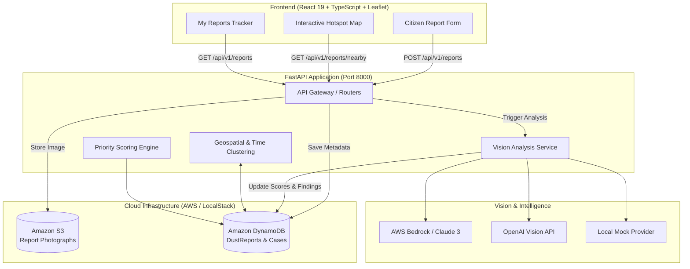

# 🌬️ VayuDrishti (वायुदृष्टि)
> **AI-Powered Urban Dust Pollution Intelligence & Investigation Platform**

[](https://fastapi.tiangolo.com)
[](https://react.dev)
[](https://www.typescriptlang.org)
[](https://vitejs.dev)
[](https://aws.amazon.com)
[](https://www.python.org)

**VayuDrishti** converts citizen-submitted dust pollution reports and photographs into verifiable, evidence-backed incident investigations. By combining geospatial correlation, automated computer-vision analysis, and AI-driven investigation dossiers, VayuDrishti empowers municipal authorities and environmental reviewers to identify recurring hotspots, prioritize inspections, and track remediation from report to resolution.

---

## 🌟 Key Features

- **📸 Resident Incident Reporting:**
  - Simple, mobile-responsive citizen reporting interface.
  - Photo upload with direct S3 storage and presigned URLs.
  - Interactive Leaflet map with GPS geolocation and pin picker.
  - Category tagging (Construction, Demolition, Uncovered Materials, Road Dust, etc.).

- **🤖 Multi-Provider Vision AI Analysis:**
  - Automated image analysis assessing dust presence, plume severity, and source classification.
  - Pluggable vision backends: **AWS Bedrock** (Claude 3 Haiku), **OpenAI Vision API**, or an offline **Mock Provider** for local testing.
  - Confidence scoring and visual evidence indicators.

- **🗺️ Geospatial & Temporal Hotspot Correlation:**
  - Automatically queries and links related reports within configurable radii (e.g., 500 meters) and time windows (e.g., 48 hours).
  - Surfaces recurring repeat offenders and persistent problem areas.

- **⚖️ Transparent Priority Scoring:**
  - Algorithmic, rule-based scoring engine that weighs visual plume severity, repeat complaint frequency, and site proximity.
  - Explains the exact contributing factors behind every priority score for objective accountability.

- **🔍 Environmental Reviewer & Investigation Workflow:**
  - Interactive incident map with real-time cluster visualization and filtering.
  - Investigation dossiers synthesizing image metadata, local weather conditions, and history.
  - Reviewer action workflow: Approve inspection dispatch, request additional evidence, or reject with audit reasoning.

- **☁️ Cloud-Native & LocalStack Ready:**
  - Built for AWS (Amazon S3, DynamoDB, Bedrock).
  - First-class support for **LocalStack** for zero-cost, 100% offline local development without AWS credentials.

---

## 🏗️ System Architecture



---

## 📁 Repository Structure

```text
VayuDrishti/
├── backend/                  # FastAPI backend service
│   ├── models/               # Pydantic schemas and database models
│   │   ├── __init__.py
│   │   └── report.py         # Request/response validation & DynamoDB schemas
│   ├── routers/              # API endpoints
│   │   └── reports.py        # POST/GET reports, nearby spatial queries, image fetch
│   ├── services/             # Core business logic
│   │   ├── dynamodb_service.py # DynamoDB operations & spatial lookups
│   │   ├── s3_service.py       # S3 image uploads & presigned URLs
│   │   └── vision_service.py   # AI vision analysis (Bedrock / OpenAI / Mock)
│   ├── config.py             # Application settings & environment variables
│   ├── main.py               # FastAPI entry point & CORS configuration
│   ├── requirements.txt      # Python dependencies
│   └── test_curl.sh          # End-to-end API testing script
├── frontend/                 # React + TypeScript + Vite frontend
│   ├── src/
│   │   ├── components/       # Reusable UI components
│   │   ├── pages/            # View pages (SubmitReport, Map, MyReports)
│   │   ├── services/         # API client & HTTP integration
│   │   ├── types/            # TypeScript interfaces
│   │   ├── App.tsx           # Application routing & layout
│   │   └── main.tsx          # React application root
│   ├── package.json          # Frontend dependencies & scripts
│   └── vite.config.ts        # Vite configuration
├── infrastructure/           # Cloud provisioning scripts
│   └── create_tables.py      # DynamoDB table schema initializer
├── run_setup.py              # Wrapper to provision DynamoDB tables from .env
├── start_backend.ps1         # PowerShell quick launcher for backend
├── .env.example              # Environment variables template
└── README.md                 # Project documentation
```

---

## 🚀 Getting Started

### Prerequisites

Ensure the following tools are installed on your machine:
- **Python 3.11+**
- **Node.js 18+** & **npm**
- **Git**
- *(Optional)* **Docker** & **LocalStack** (if developing offline without AWS credentials)

---

### 1. Environment Configuration

Copy the example environment file into `.env` at the root of the project:

```bash
cp .env.example .env
```

Key environment configurations in `.env`:

| Variable | Description | Default / Options |
| :--- | :--- | :--- |
| `USE_LOCALSTACK` | Route AWS calls to local LocalStack endpoint | `false` (or `true` for offline dev) |
| `AWS_REGION` | AWS region | `ap-south-1` (or `us-east-1`) |
| `S3_BUCKET_NAME` | S3 bucket for storing incident images | `vayu-drishti-reports` |
| `VISION_PROVIDER` | Computer vision provider | `mock` (recommended for dev), `bedrock`, `openai` |
| `OPENAI_API_KEY` | API Key if using `VISION_PROVIDER=openai` | `sk-...` |
| `NEARBY_RADIUS_METERS` | Clustering radius for related reports | `500` |
| `NEARBY_TIME_WINDOW_HOURS` | Time window for correlating incidents | `48` |

---

### 2. Backend Setup

1. **Create and activate a virtual environment:**
   ```bash
   # Windows PowerShell
   python -m venv .venv
   .\.venv\Scripts\Activate.ps1

   # Linux / macOS
   python3 -m venv .venv
   source .venv/bin/activate
   ```

2. **Install dependencies:**
   ```bash
   pip install -r backend/requirements.txt
   ```

3. **Initialize DynamoDB Tables:**
   Run the setup script to provision the required DynamoDB tables (`DustReports`, `IncidentCases`, `ReviewDecisions`, `AuditEvents`):
   ```bash
   python run_setup.py
   ```

4. **Start the FastAPI server:**
   ```bash
   # Using the PowerShell launcher:
   .\start_backend.ps1

   # Or manually using uvicorn:
   cd backend
   python -m uvicorn main:app --reload --port 8000
   ```

   - API server running at: `http://127.0.0.1:8000`
   - Interactive Swagger docs: `http://127.0.0.1:8000/docs`
   - ReDoc documentation: `http://127.0.0.1:8000/redoc`

---

### 3. Frontend Setup

1. **Navigate to the frontend directory:**
   ```bash
   cd frontend
   ```

2. **Install frontend dependencies:**
   ```bash
   npm install
   ```

3. **Start the development server:**
   ```bash
   npm run dev
   ```

   The application will be available at `http://localhost:5173`.

---

## 📡 API Overview

| Method | Endpoint | Description |
| :--- | :--- | :--- |
| `POST` | `/api/v1/reports` | Submit a new dust report with image (multipart upload) |
| `GET` | `/api/v1/reports/{report_id}` | Retrieve details and AI findings for a specific report |
| `GET` | `/api/v1/reports` | List submitted reports with optional limit/pagination |
| `GET` | `/api/v1/reports/nearby` | Query reports within radius of coordinates (`lat`, `lon`, `radius_km`) |
| `GET` | `/api/v1/reports/{report_id}/image-url` | Generate a secure, presigned S3 URL to view the uploaded photograph |
| `GET` | `/health` | Health check and service status probe |

---

## 🧪 Testing

### Backend API Verification
You can test the full report submission, image upload, and AI analysis pipeline using the included script:

```bash
# From project root
bash backend/test_curl.sh
```

### Frontend Typechecking & Linting
```bash
cd frontend
npm run build   # TypeScript typecheck & production build
npm run lint    # Oxlint static analysis
```

---

## 🛡️ License

This project is licensed under the MIT License — see the repository for details.
